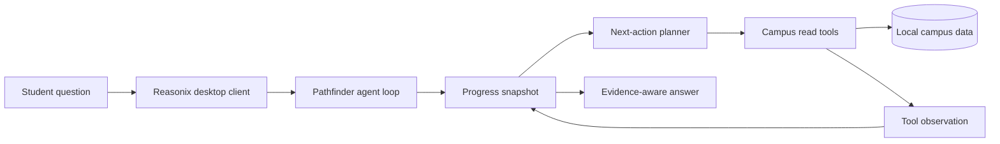

# Pathfinder UCD

<p align="center">
  <strong>A progress-aware academic consultation agent for UC Davis students.</strong>
</p>

<p align="center">
  <a href="./README.zh-CN.md">简体中文</a>
  ·
  <a href="./docs/superpowers/specs/2026-07-16-pathfinder-progress-aware-agent-design.md">Design specification</a>
  ·
  <a href="./LICENSE">MIT License</a>
</p>

Pathfinder UCD keeps the mature DeepSeek-Reasonix desktop client and replaces its coding-oriented agent behavior with an academic consultation workflow. It helps students explore courses, instructors, majors, change-of-major requirements, and university calendar information using local campus datasets and evidence-aware answers.

> [!NOTE]
> Pathfinder is an application built on the DeepSeek-Reasonix client foundation. It is not a separate Pathfinder web page and does not reproduce the PROGRA training pipeline.

## Why Pathfinder

Academic questions often take more than one lookup. A useful answer may require confirming the student's goal, searching several data sources, comparing constraints, preserving earlier decisions, and knowing when enough evidence has been collected.

Pathfinder adds an inference-time progress layer to the existing Reasonix agent loop:

- reconstructs a compact consultation state before each model turn;
- separates completed work, current work, missing information, and next actions;
- uses a read-only task plan for longer consultations;
- avoids repeating identical successful campus queries;
- requires successful campus evidence before a managed task can be marked complete;
- keeps direct questions lightweight instead of forcing every request through a long plan.

## Capabilities

- **Professor discovery** — search instructor profiles, course associations, reviews, and review keywords.
- **Course consultation** — query course records and combine them with instructor evidence.
- **Major exploration** — inspect major catalogs and compare academic options.
- **Change-of-major guidance** — query and compare requirements while clearly separating official facts from interpretation.
- **Academic calendar lookup** — retrieve relevant UC Davis dates from the local calendar database.
- **Local knowledge retrieval** — search curated text and Markdown references.
- **Progress-aware planning** — maintain a bounded, transient state note across multi-turn tool use.
- **Evidence-aware responses** — surface uncertainty and avoid presenting unsupported conclusions as official policy.

## How it works



For a managed consultation, each decision cycle follows:

```text
understand progress → plan next action → call a tool → inspect evidence → update progress → finish when complete
```

The progress snapshot is generated from the current request, active consultation tasks, and campus tool observations. It is injected as transient context, capped in size, and removed from durable conversation history.

## Architecture

| Layer | Responsibility |
| --- | --- |
| `desktop/` | Wails desktop shell and the existing Reasonix React interface |
| `internal/agent/` | Conversation loop, transient turn context, tool execution, and completion checks |
| `internal/campus/progress/` | Consultation classification and compact progress reconstruction |
| `internal/campus/native/` | Read-only campus tools, consultation task planning, and successful-query cache |
| `internal/campus/evidence/` | Evidence checks used by managed-task completion rules |
| `internal/campus/config/` | Campus data discovery and runtime paths |
| `internal/boot/` | Pathfinder prompt, tool registration, and application wiring |

The frontend remains the DeepSeek-Reasonix desktop experience. Pathfinder's academic identity, prompt policy, planning rules, and campus tools live in the backend.

## Quick start

### Prerequisites

- macOS for the currently verified desktop workflow;
- Go 1.26.4;
- Node.js and pnpm;
- Wails v2;
- a DeepSeek or other OpenAI-compatible API key;
- a Pathfinder campus data directory.

Install Wails if it is not already available:

```sh
go install github.com/wailsapp/wails/v2/cmd/wails@latest
```

Install frontend dependencies and start the desktop client:

```sh
pnpm --dir desktop/frontend install
export PATHFINDER_DATA_ROOT=/absolute/path/to/RMPdemo/data
./dev
```

The local helper `desktop/scripts/run-pathfinder-local.sh` can also build and launch the desktop binary. When `PATHFINDER_DATA_ROOT` is unset, it looks for `RMPdemo/data` beside this repository.

## Model provider configuration

The desktop Settings view is the recommended way to configure a provider. A minimal DeepSeek-compatible configuration looks like this:

```toml
default_model = "deepseek-flash"

[[providers]]
name        = "deepseek-flash"
kind        = "openai"
base_url    = "https://api.deepseek.com"
model       = "deepseek-v4-flash"
api_key_env = "DEEPSEEK_API_KEY"
```

Then provide the key to the application environment:

```sh
export DEEPSEEK_API_KEY=sk-...
```

Do not commit API keys or local configuration containing secrets.

## Campus data

Set `PATHFINDER_DATA_ROOT` to a directory containing the campus resources you want Pathfinder to use. Supported sources currently include:

```text
data/
├── rmp.db
├── courses.db
├── majors.db
├── changemajor.db
├── ucdavis_calendar.db
└── txt/
    ├── *.txt
    └── *.md
```

Not every file is required. Pathfinder only registers campus behavior when a usable data root is discovered. Desktop builds may also bundle a `data` directory inside the macOS application resources.

Runtime path overrides:

| Variable | Purpose |
| --- | --- |
| `PATHFINDER_DATA_ROOT` | Explicit campus dataset root |
| `PATHFINDER_APP_DATA_DIR` | Override Pathfinder's writable application-data directory |

## Campus tools

Pathfinder exposes narrowly scoped, read-only consultation tools:

| Area | Tools |
| --- | --- |
| Professors and reviews | `search_professors`, `professors_for_course`, `professor_reviews`, `search_reviews_by_keywords`, `query_rmp_table` |
| Courses and calendar | `query_course_db`, `query_ucdavis_calendar` |
| Majors | `query_major_catalog` |
| Change of major | `query_change_major`, `compare_change_major_requirements` |
| Local references | `search_txt_context` |
| Consultation progress | `todo_write` |

`todo_write` records consultation progress only. It does not modify campus records or perform external actions.

## Development

Run the frontend separately:

```sh
cd desktop/frontend
pnpm dev
```

Run the desktop application with live reload:

```sh
cd desktop
wails dev -nosyncgomod
```

Build a local desktop binary:

```sh
cd desktop
wails build -clean -nopackage
./build/bin/pathfinder-ucd
```

The release packaging pipeline is still being adapted from Reasonix. Treat local Wails builds as the supported development path for now.

## Testing

Run the progress-aware backend tests:

```sh
go test ./internal/campus/progress ./internal/campus/native ./internal/evidence
go test ./internal/agent -run 'Test(RunInjectsTurnContextAndKeepsVisibleUserTextClean|StripTransientUserBlocksRemovesConsultationProgress|ProgressReadToolBlocksFinalWithIncompleteTodo|MissingInputQuestionAllowedBeforeProgressRead)$'
go test ./internal/boot -run 'TestBuildInjects(PathfinderPromptAndToolsWhenCampusDataExists|CampusProgressIntoManagedUserTurn)$'
```

Run the frontend checks:

```sh
pnpm --dir desktop/frontend build
pnpm --dir desktop/frontend test:all
```

Some legacy Reasonix tests still describe removed coding tools and are being migrated to Pathfinder's read-only campus boundary. Prefer the focused suites above when working on the academic agent.

## Privacy and safety

- Campus databases are read locally; Pathfinder tools do not mutate them.
- The configured model provider receives the conversation and the retrieved excerpts needed to answer the request, not direct database access.
- Retrieved text is treated as evidence, not as executable instructions.
- Academic requirements can change. Pathfinder should cite the source it used, state uncertainty, and recommend official advisor or registrar confirmation for high-impact decisions.
- API keys remain local configuration and must not be committed to the repository.

## Troubleshooting

**Campus tools do not appear**

Confirm that `PATHFINDER_DATA_ROOT` points to an existing directory containing at least one supported database or text resource, then restart the desktop app.

**The app opens but the model cannot answer**

Check the provider URL, model identifier, API key environment variable, and network access in Settings.

**Wails cannot find frontend dependencies**

Run `pnpm --dir desktop/frontend install`, then restart `wails dev`.

**A long consultation stops before completion**

Inspect the visible task state and the latest tool result. Managed consultations intentionally remain incomplete until at least one campus read succeeds.

## Roadmap

- [x] Preserve the Reasonix desktop client as the Pathfinder frontend.
- [x] Add an academic system prompt and campus-only tool policy.
- [x] Add transient progress reconstruction and managed consultation plans.
- [x] Add successful-query deduplication and evidence-gated completion.
- [ ] Add source citations and evidence cards to the desktop response UI.
- [ ] Add advisor-review handoff and exportable consultation summaries.
- [ ] Complete signed and reproducible desktop release packaging.
- [ ] Build an evaluation set for multi-turn academic consultation quality.

## Research inspiration

Pathfinder's runtime design is inspired by **PROGRA: Progress-Aware Reinforcement Learning for Multi-Turn Function Calling** and its central idea that an agent should summarize task history and plan future actions before selecting the next tool.

This repository currently implements an **inference-time adaptation** of that idea: prompt policy, transient progress state, tool planning, query deduplication, and completion checks. It does **not** implement PROGRA's PAG data-generation pipeline, SFT warm-up, reinforcement learning procedure, or claim the benchmark gains reported by the paper.

- [PROGRA paper](https://aclanthology.org/2026.findings-acl.325.pdf)
- [PROGRA source code](https://github.com/FatCatCHC/Progra)
- [Pathfinder progress-aware design specification](./docs/superpowers/specs/2026-07-16-pathfinder-progress-aware-agent-design.md)

## Contributing

Issues and focused pull requests are welcome. Please keep contributions aligned with the campus consultation boundary, add tests for behavioral changes, and avoid reintroducing filesystem, shell, or coding-agent tools into the student-facing runtime.

## License

Pathfinder UCD is distributed under the [MIT License](./LICENSE). It retains and adapts code from the DeepSeek-Reasonix project; applicable notices and repository history should be preserved.
