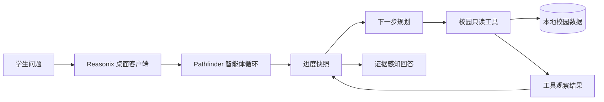

# Pathfinder UCD

<p align="center">
  <strong>面向 UC Davis 学生的进度感知学术咨询智能体。</strong>
</p>

<p align="center">
  <a href="./README.md">English</a>
  ·
  <a href="./docs/superpowers/specs/2026-07-16-pathfinder-progress-aware-agent-design.md">设计规格</a>
  ·
  <a href="./LICENSE">MIT 许可证</a>
</p>

Pathfinder UCD 保留成熟的 DeepSeek-Reasonix 桌面客户端，并把原本面向编程的智能体行为改造成学术咨询工作流。它基于本地校园数据，帮助学生查询课程、教授、专业、转专业要求与校历信息，并生成有证据边界的回答。

> [!NOTE]
> Pathfinder 是基于 DeepSeek-Reasonix 客户端基础开发的应用，不是另做一套 Pathfinder 网页，也没有复现 PROGRA 的训练流程。

## 为什么需要 Pathfinder

真实的校园咨询通常不只需要一次检索。一个可靠答案可能要先确认学生目标，再查询多个数据源、比较条件、保留此前决定，并判断什么时候已经收集到足够证据。

Pathfinder 在现有 Reasonix 智能体循环中加入了运行时进度层：

- 每次模型决策前重建紧凑的咨询状态；
- 区分已完成事项、当前事项、缺失信息与下一步行动；
- 对较长咨询使用只读任务计划；
- 避免重复执行参数完全相同且已成功的校园查询；
- 只有校园读取工具成功返回证据后，复杂任务才能标记完成；
- 简单直接的问题保持轻量，不强制展开冗长计划。

## 核心能力

- **教授发现**：搜索教授资料、授课关联、评价与评价关键词。
- **课程咨询**：查询课程记录，并结合教授证据辅助选课判断。
- **专业探索**：查看专业目录，比较不同学术方向。
- **转专业指导**：查询和比较转专业要求，明确区分正式事实与模型解释。
- **校历查询**：从本地校历数据库检索 UC Davis 重要日期。
- **本地知识检索**：搜索整理过的文本与 Markdown 参考资料。
- **进度感知规划**：在多轮工具调用中维护有长度边界的临时任务状态。
- **证据感知回答**：主动说明不确定性，不把无依据结论包装成官方政策。

## 工作原理



复杂咨询的每个决策周期遵循：

```text
理解当前进度 → 规划下一步 → 调用工具 → 检查证据 → 更新进度 → 满足条件后结束
```

进度快照根据当前问题、咨询任务列表和校园工具结果重建，以临时上下文注入模型；其长度受到限制，也不会写入长期对话历史。

## 架构

| 层级 | 职责 |
| --- | --- |
| `desktop/` | Wails 桌面外壳与保留的 Reasonix React 界面 |
| `internal/agent/` | 对话循环、临时轮次上下文、工具执行与完成条件 |
| `internal/campus/progress/` | 咨询类型判断和紧凑进度重建 |
| `internal/campus/native/` | 校园只读工具、咨询任务规划与成功查询缓存 |
| `internal/campus/evidence/` | 复杂任务完成前的证据检查 |
| `internal/campus/config/` | 校园数据发现和运行时路径 |
| `internal/boot/` | Pathfinder 提示词、工具注册与应用接线 |

前端继续使用 DeepSeek-Reasonix 桌面体验；Pathfinder 的学术身份、提示策略、规划规则与校园工具全部位于后台。

## 快速开始

### 环境要求

- macOS（当前已验证的桌面开发环境）；
- Go 1.26.4；
- Node.js 与 pnpm；
- Wails v2；
- DeepSeek 或其他 OpenAI 兼容服务的 API Key；
- Pathfinder 校园数据目录。

如未安装 Wails：

```sh
go install github.com/wailsapp/wails/v2/cmd/wails@latest
```

安装前端依赖并启动桌面客户端：

```sh
pnpm --dir desktop/frontend install
export PATHFINDER_DATA_ROOT=/绝对路径/RMPdemo/data
./dev
```

也可以使用 `desktop/scripts/run-pathfinder-local.sh` 构建并启动桌面二进制。如果没有设置 `PATHFINDER_DATA_ROOT`，脚本会尝试读取本仓库同级的 `RMPdemo/data`。

## 模型服务配置

推荐在桌面端的“设置”页面配置模型服务。最小 DeepSeek 兼容配置示例：

```toml
default_model = "deepseek-flash"

[[providers]]
name        = "deepseek-flash"
kind        = "openai"
base_url    = "https://api.deepseek.com"
model       = "deepseek-v4-flash"
api_key_env = "DEEPSEEK_API_KEY"
```

然后向应用环境提供密钥：

```sh
export DEEPSEEK_API_KEY=sk-...
```

不要把 API Key 或含有密钥的本地配置提交到仓库。

## 校园数据

将 `PATHFINDER_DATA_ROOT` 指向 Pathfinder 要使用的校园资源目录。目前支持：

```text
data/
├── rmp.db
├── courses.db
├── majors.db
├── changemajor.db
├── ucdavis_calendar.db
└── txt/
    ├── *.txt
    └── *.md
```

这些文件不要求全部存在。Pathfinder 只有在发现可用数据根目录后才会注册校园咨询行为。桌面发行包也可以在 macOS 应用资源中内置 `data` 目录。

运行时路径变量：

| 变量 | 用途 |
| --- | --- |
| `PATHFINDER_DATA_ROOT` | 显式指定校园数据根目录 |
| `PATHFINDER_APP_DATA_DIR` | 覆盖 Pathfinder 可写应用数据目录 |

## 校园工具

Pathfinder 提供边界清晰的只读咨询工具：

| 范围 | 工具 |
| --- | --- |
| 教授与评价 | `search_professors`、`professors_for_course`、`professor_reviews`、`search_reviews_by_keywords`、`query_rmp_table` |
| 课程与校历 | `query_course_db`、`query_ucdavis_calendar` |
| 专业 | `query_major_catalog` |
| 转专业 | `query_change_major`、`compare_change_major_requirements` |
| 本地资料 | `search_txt_context` |
| 咨询进度 | `todo_write` |

`todo_write` 只记录咨询进度，不会修改校园数据，也不会执行任何外部操作。

## 开发

单独启动前端：

```sh
cd desktop/frontend
pnpm dev
```

以热更新模式启动桌面应用：

```sh
cd desktop
wails dev -nosyncgomod
```

构建本地桌面二进制：

```sh
cd desktop
wails build -clean -nopackage
./build/bin/pathfinder-ucd
```

发行打包流程仍在从 Reasonix 适配到 Pathfinder。现阶段请把本地 Wails 构建作为受支持的开发方式。

## 测试

运行进度感知后台测试：

```sh
go test ./internal/campus/progress ./internal/campus/native ./internal/evidence
go test ./internal/agent -run 'Test(RunInjectsTurnContextAndKeepsVisibleUserTextClean|StripTransientUserBlocksRemovesConsultationProgress|ProgressReadToolBlocksFinalWithIncompleteTodo|MissingInputQuestionAllowedBeforeProgressRead)$'
go test ./internal/boot -run 'TestBuildInjects(PathfinderPromptAndToolsWhenCampusDataExists|CampusProgressIntoManagedUserTurn)$'
```

运行前端检查：

```sh
pnpm --dir desktop/frontend build
pnpm --dir desktop/frontend test:all
```

部分旧 Reasonix 测试仍在描述已经移除的编程工具，目前正迁移到 Pathfinder 的校园只读边界。开发学术智能体时，请优先运行上面的定向测试。

## 隐私与安全

- 校园数据库在本地读取，Pathfinder 工具不会修改这些数据库。
- 模型服务商会收到回答当前问题所需的对话和检索片段，但不会直接访问数据库。
- 检索到的文本只作为证据，不作为可执行指令。
- 学术要求可能发生变化。对于重要决定，Pathfinder 应标明信息来源与不确定性，并建议向官方 advisor 或 registrar 复核。
- API Key 保留在本地配置中，不得提交到代码仓库。

## 常见问题

**看不到校园工具**

确认 `PATHFINDER_DATA_ROOT` 指向真实存在的目录，并至少包含一个支持的数据库或文本资源，然后重启桌面应用。

**应用能打开，但模型无法回答**

在设置中检查服务地址、模型标识、API Key 环境变量和网络连接。

**Wails 找不到前端依赖**

执行 `pnpm --dir desktop/frontend install`，然后重新启动 `wails dev`。

**复杂咨询提前停止**

检查可见的任务状态和最近一次工具结果。复杂咨询只有在至少一次校园读取成功后才能完成，这是有意设置的证据门槛。

## 路线图

- [x] 保留 Reasonix 桌面客户端作为 Pathfinder 前端。
- [x] 加入学术系统提示词与校园工具边界。
- [x] 加入临时进度重建与复杂咨询任务计划。
- [x] 加入成功查询去重和基于证据的完成条件。
- [ ] 在桌面回答中加入来源引用与证据卡片。
- [ ] 加入 advisor 复核交接与可导出的咨询摘要。
- [ ] 完成签名、可复现的桌面发行打包。
- [ ] 建立多轮学术咨询质量评测集。

## 研究启发

Pathfinder 的运行时设计受到 **PROGRA: Progress-Aware Reinforcement Learning for Multi-Turn Function Calling** 启发。其核心思想是：智能体在选择下一项工具前，应先总结任务历史并规划后续行动。

本仓库目前实现的是该思想的**推理时适配**：提示策略、临时进度状态、工具规划、查询去重与完成检查。项目没有实现 PROGRA 的 PAG 数据生成、SFT warm-up 或强化学习流程，也不宣称获得论文报告的基准提升。

- [PROGRA 论文](https://aclanthology.org/2026.findings-acl.325.pdf)
- [PROGRA 开源代码](https://github.com/FatCatCHC/Progra)
- [Pathfinder 进度感知设计规格](./docs/superpowers/specs/2026-07-16-pathfinder-progress-aware-agent-design.md)

## 参与贡献

欢迎提交 issue 和范围清晰的 pull request。行为变更应附带测试，并保持校园咨询边界；请勿把文件系统、Shell 或编程智能体工具重新引入面向学生的运行时。

## 许可证

Pathfinder UCD 使用 [MIT 许可证](./LICENSE) 发布。项目保留并改造了 DeepSeek-Reasonix 的代码，相关版权声明与仓库历史应继续保留。
