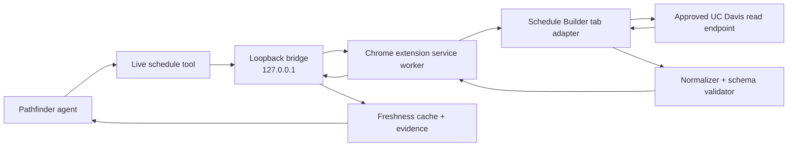

# Pathfinder Schedule Bridge Design

**Status:** Approved for implementation  
**Date:** 2026-07-16  
**Product:** Pathfinder UCD desktop application + Chrome extension  
**Extension directory:** `extensions/pathfinder-schedule-bridge/`

## 1. Summary

Pathfinder currently answers campus questions from local SQLite and text datasets. Those sources remain useful for catalog, major, professor, and policy context, but they cannot guarantee current course offerings, Section availability, seat counts, waitlists, registration restrictions, personal schedules, pass times, or holds.

The Schedule Bridge adds an on-demand, read-only path from the Pathfinder desktop agent to UC Davis course data visible in the student's browser. When the agent needs fresh data, the desktop app asks the student to open Chrome and sign in to Schedule Builder. The extension detects the authenticated page, executes an approved course query in that browser context, normalizes the response, and returns evidence to Pathfinder over a paired loopback connection.

The browser retains all authentication material. Passwords, cookies, session identifiers, and CSRF tokens never enter Pathfinder or the model prompt.

## 2. Goals

1. Let Pathfinder request current UC Davis course and Section data while answering a student.
2. Preserve the existing Reasonix-based desktop client and add the workflow as backend tools plus small connection/consent UI surfaces.
3. Make setup accessible to non-technical students: install the desktop app, install the extension, pair once, and sign in through the normal UC Davis page when needed.
4. Query Schedule Builder only when fresh or personal data is required; do not continuously mirror the site.
5. Return all Sections for a requested course, including paginated results, as one normalized course result.
6. Support multiple courses through a visible, cancellable, single-concurrency queue without a fixed eight-course limit.
7. Allow personal schedule, pass time, hold, and personal waitlist context only after explicit per-session consent.
8. Keep the integration read-only by construction and fail closed when the site contract changes.
9. Provide source, term, retrieval time, freshness, and authentication provenance for every result.

## 3. Non-goals

- Registering, dropping, swapping, waitlisting, saving schedules, or changing any university record.
- Entering credentials, automating Kerberos login, handling MFA, or solving CAPTCHA challenges.
- Hiding the extension, spoofing browser identity, simulating human behavior, or evading university detection or controls.
- Ignoring `Retry-After`, bypassing rate limits, or retrying forbidden requests.
- Long-running unattended scraping or building a central copy of UC Davis student data.
- Sending raw pages, cookies, CSRF tokens, or unfiltered API payloads to the desktop app.
- Depending on an undocumented API shape inside the Pathfinder agent core.

## 4. User experience

### 4.1 Initial setup

1. The student installs Pathfinder UCD.
2. The student installs the Pathfinder Schedule Bridge extension from a trusted distribution channel.
3. Pathfinder shows a short-lived pairing code.
4. The student enters the code in the extension popup.
5. The extension and app exchange a long-lived random pairing credential and show a connected state.

Pairing is a one-time action for the same desktop profile and browser profile. Reinstalling either side or explicitly revoking the pairing requires a new code.

### 4.2 On-demand course query

1. The agent decides that current course data is necessary and calls `query_live_schedule`.
2. If Chrome, the extension, or an authenticated Schedule Builder tab is unavailable, the tool returns a recoverable status rather than a fabricated result.
3. The desktop transcript displays a card explaining which course and term Pathfinder wants to query.
4. The student selects **Open Schedule Builder** and completes the normal UC Davis login themselves.
5. The extension reports `READY` after recognizing a supported authenticated page.
6. Pathfinder automatically resumes the original request using the same request ID.
7. The extension queries courses sequentially, reports progress, and returns normalized evidence.
8. The agent continues its progress-aware plan and answers with freshness and source information.

The student does not need to restate the question after logging in.

### 4.3 Personal academic context

When a request benefits from the student's schedule, pass time, registration holds, or personal waitlist position, Pathfinder displays a session-scoped consent prompt before querying those fields. The prompt states:

- the categories requested;
- that data travels from the browser to the local Pathfinder app;
- that relevant results may be sent to the student's configured model provider as part of the tool result;
- that passwords, cookies, CSRF tokens, and unrelated page content are excluded.

Choices are **Allow for this session** and **Not now**. Personal-data permission is never silently inferred from general extension pairing.

## 5. Architecture



### 5.1 Desktop components

New Go packages should remain small and independently testable:

- `internal/campus/livebridge/protocol`: versioned message envelopes, schemas, validation, status codes, and size limits.
- `internal/campus/livebridge/server`: loopback WebSocket lifecycle, pairing, authentication, request correlation, cancellation, and extension status.
- `internal/campus/livebridge/cache`: public-data cache, freshness metadata, and in-memory personal-data cache.
- `internal/campus/livebridge/client`: typed request interface used by tools; no WebSocket details leak into campus tools.
- `internal/campus/native/live_schedule_tool.go`: the provider-visible `query_live_schedule` tool.
- `desktop/schedule_bridge_app.go`: Wails methods and events for pairing, browser-required cards, consent, status, and progress.

The agent tool calls a typed bridge client. It does not know Chrome tabs, URLs, cookies, or Schedule Builder endpoint details.

### 5.2 Extension components

The extension lives entirely under `extensions/pathfinder-schedule-bridge/`:

```text
extensions/pathfinder-schedule-bridge/
├── manifest.json
├── package.json
├── tsconfig.json
├── vite.config.ts
├── src/
│   ├── background/
│   │   ├── bridge-client.ts
│   │   ├── request-router.ts
│   │   ├── query-queue.ts
│   │   └── cache.ts
│   ├── content/
│   │   ├── page-status.ts
│   │   └── schedule-builder-adapter.ts
│   ├── page/
│   │   └── main-world-api.ts
│   ├── protocol/
│   │   ├── messages.ts
│   │   └── schemas.ts
│   ├── normalize/
│   │   └── schedule.ts
│   └── popup/
│       ├── index.html
│       ├── popup.ts
│       └── popup.css
├── tests/
│   ├── fixtures/
│   ├── protocol.test.ts
│   ├── queue.test.ts
│   ├── normalize.test.ts
│   └── readonly-policy.test.ts
└── README.md
```

The Manifest V3 service worker owns the loopback connection, request queue, cache, and routing. A content script detects supported tabs and mediates page status. Approved API requests execute in the page's main world so they use the browser's existing same-origin authentication. Only sanitized data crosses back to the service worker.

No secret pairing token is injected into the page's main world.

### 5.3 Site adapter boundary

Schedule Builder endpoints may be undocumented and may change. All URL paths, request shapes, response shapes, term identifiers, pagination rules, and login detection live behind a `ScheduleProvider` interface in the extension.

```ts
interface ScheduleProvider {
  status(): Promise<PageStatus>;
  terms(): Promise<Term[]>;
  searchCourse(input: CourseQuery): Promise<RawCourseResult>;
  personalContext(input: PersonalContextQuery): Promise<RawPersonalContext>;
}
```

The first implementation must audit actual Schedule Builder network requests after a user completes login. Only observed read operations are added to the allowlist. If an authenticated API cannot be safely and reliably called, the provider returns `SITE_VERSION_UNSUPPORTED`; it does not fall back to mutation-capable automation.

The public UC Davis Class Search Tool can be implemented as an additional live provider for general course data. UC Davis describes that tool as live and intended for schedule planning. Schedule Builder remains the preferred source for authenticated and personal context.

## 6. Communication transport

### 6.1 Choice

The first release uses a loopback WebSocket server owned by the running Pathfinder app.

Reasons:

- the installation flow needs only the desktop app and browser extension;
- the app can push queries and receive progress over one long-lived channel;
- it works across Chromium browsers with the same extension architecture;
- it avoids per-platform Native Messaging host registration in the first release.

Chrome Native Messaging is a possible later hardening option once signed installers reliably register and update native host manifests. It is not required for the first implementation.

### 6.2 Binding and discovery

- Bind only to `127.0.0.1`; never bind `0.0.0.0`, a LAN interface, or a public socket.
- Use a fixed documented primary port with a small deterministic fallback range for port conflicts.
- The extension tries only that range and validates the Pathfinder handshake before pairing.
- Reject browser-page WebSocket origins. Only the extension's configured origin and authenticated clients may proceed beyond `hello`.
- A health response contains no student data, conversation data, or pairing credential.

### 6.3 Pairing

1. Pathfinder generates a cryptographically random, short-lived pairing challenge and displays a human-readable code.
2. The extension submits the code with its extension ID, protocol version, and a random client nonce.
3. Pathfinder validates the code, creates a 256-bit pairing credential, and returns it once over the paired channel.
4. The extension stores the credential in extension-local storage.
5. Pathfinder stores its credential in the platform credential store when available; a permission-restricted local secret is the fallback.
6. Pairing codes expire after five minutes and succeed only once.
7. Either side can revoke the credential.

Long-lived credentials are never logged or placed in URLs.

## 7. Protocol

All messages are JSON and use protocol version `1`.

### 7.1 Envelope

```json
{
  "protocol": 1,
  "id": "req_01J...",
  "type": "request",
  "method": "schedule.search",
  "sent_at": "2026-07-16T09:42:18Z",
  "params": {}
}
```

Every message is validated for:

- supported protocol version;
- known type and method;
- request ID format and correlation;
- maximum encoded size;
- method-specific parameter schema;
- allowed string lengths and collection sizes;
- absence of unknown privileged fields.

### 7.2 Methods

- `bridge.status`: extension, supported-tab, authentication, provider-version, and consent readiness.
- `schedule.terms`: current terms exposed by the supported provider.
- `schedule.search`: one or more normalized course identifiers; returns every available Section for each requested course.
- `schedule.personal`: personal schedule, pass time, holds, and personal waitlist context within granted session categories.
- `request.cancel`: cancel queued work and stop before the next provider request.

### 7.3 Result statuses

- `OK`
- `PARTIAL`
- `BROWSER_REQUIRED`
- `EXTENSION_REQUIRED`
- `PAIRING_REQUIRED`
- `LOGIN_REQUIRED`
- `CONSENT_REQUIRED`
- `RATE_LIMITED`
- `SITE_VERSION_UNSUPPORTED`
- `INVALID_REQUEST`
- `CANCELLED`
- `INTERNAL_ERROR`

`BROWSER_REQUIRED`, `LOGIN_REQUIRED`, and `CONSENT_REQUIRED` are recoverable. Pathfinder retains the request ID and may resume after the corresponding state becomes ready. Requests are idempotent from the app's perspective; duplicate IDs cannot start duplicate queues.

### 7.4 Evidence

Every successful course result includes:

```json
{
  "source": "ucd_schedule_builder",
  "source_url": "https://my.ucdavis.edu/schedulebuilder/",
  "provider_version": "schedule-builder-2026-07",
  "fetched_at": "2026-07-16T09:42:18Z",
  "term": "2026-fall",
  "freshness": "live",
  "authenticated": true,
  "courses": []
}
```

Normalized course records include course code, title when available, CRN, Section, instructor, meetings, location, units, enrollment status, available seats, waitlist data, restrictions, notes, and cancellation status. Missing fields remain explicitly absent or unknown; the normalizer must not infer official facts.

## 8. Read-only policy

Read-only is enforced at multiple layers:

1. The protocol exposes no generic URL fetch or arbitrary script method.
2. The request router accepts only named read methods.
3. The site adapter uses an exact host, path, operation, and parameter allowlist.
4. Request bodies are reconstructed from validated course inputs; raw model-generated bodies are never forwarded.
5. Response redirects must remain on approved UC Davis hosts.
6. Mutation-related paths and action names are denied even if the site uses POST for both queries and mutations.
7. Tests contain known mutation examples and prove they are rejected.

HTTP method alone does not determine safety because some read searches may use POST. Business-semantic allowlisting is authoritative.

## 9. Query pacing and cancellation

- Concurrency is exactly one provider request at a time.
- A course is the queue unit. All Sections and required pages for that course are merged into one course result.
- Multiple courses are processed sequentially with no fixed eight-course product limit.
- There is a configurable minimum delay between provider requests plus a small bounded scheduling jitter used only for load smoothing.
- The extension does not attempt to imitate human behavior or conceal automation.
- The UI displays the current course, completed count, queued count, elapsed time, and a cancel action.
- `429` pauses the queue and honors `Retry-After`; absent that header, use conservative exponential backoff with a maximum retry count.
- `401`, `403`, login redirects, or authentication markers stop the queue and return `LOGIN_REQUIRED` or a non-retryable forbidden result as appropriate.
- CAPTCHA or explicit bot challenges stop the queue and require manual user handling; the extension does not bypass them.
- Site-contract validation failure stops the affected query and returns `SITE_VERSION_UNSUPPORTED`.

The delay and retry policy are centralized and cannot be overridden by model parameters.

## 10. Cache and freshness

Cache retention and evidence freshness are separate concepts.

| Data | Retention | May be labeled live for |
| --- | ---: | ---: |
| Course and Section structure | 30 minutes | 30 minutes |
| Seat and general waitlist availability | 30 minutes | 60 seconds |
| Personal schedule | Memory only, 5 minutes | 5 minutes |
| Pass time, holds, personal waitlist | Memory only, 5 minutes | 5 minutes |

An older retained seat result may be shown immediately as stale evidence while a refresh is queued, but the agent must not describe it as current. Cache keys include provider, term, normalized course identifier, requested field categories, and authenticated/public scope.

Personal cache entries are erased when the session ends, consent is revoked, pairing is revoked, or the extension disconnects for an extended period. They are never written to the long-lived public-data cache.

## 11. Privacy and data minimization

- The page adapter extracts only fields required by the requested protocol method.
- Authentication material never crosses the browser boundary.
- Raw HTML and complete API responses are not sent to Pathfinder.
- Personal fields require session-scoped category consent.
- Student identifiers are removed unless an identifier is strictly required to interpret the requested result; the first release should not require one.
- Logs contain request IDs, method names, timing, status, and counts, not course payloads or personal fields by default.
- The desktop UI shows which model provider may receive relevant tool results.
- Revoking consent clears in-memory personal evidence and prevents further `schedule.personal` calls.

## 12. Error handling

The desktop app distinguishes setup, recoverable, and terminal errors:

- **Setup:** extension missing, pairing missing, incompatible protocol.
- **Recoverable:** browser closed, Schedule Builder tab absent, login required, consent required, rate-limited.
- **Terminal for current request:** invalid query, unsupported site version, denied endpoint, malformed response, provider forbidden, cancelled.

The agent receives structured statuses rather than prose-only errors so progress awareness can plan the next step without repeatedly calling the same failed tool. Identical unresolved calls are deduplicated until bridge state changes.

Partial course results may be returned only with `PARTIAL`, explicit missing-course errors, and per-course timestamps. The agent must disclose incomplete coverage.

## 13. Installation and distribution

The extension README provides:

- Chrome Web Store installation when available;
- developer-mode installation for local builds;
- one-screen pairing instructions;
- a connection diagnostic checklist;
- exact permissions with plain-language justification;
- privacy and read-only guarantees.

The extension requests only the minimum permissions required for storage, active Schedule Builder/Class Search tabs, scripting on approved UC Davis hosts, and loopback communication. Broad browsing-history or all-sites permissions are prohibited.

The desktop app provides **Extension not installed**, **Pair extension**, **Connected**, **Login required**, **Ready**, and **Site update required** states.

## 14. Testing strategy

### 14.1 Protocol and bridge

- Go and TypeScript fixtures prove compatible serialization for every message type.
- Pairing-code expiry, one-time use, credential rotation, revocation, bad-origin, bad-token, oversized-message, and replay tests.
- Request correlation, idempotency, cancellation, reconnect, and recoverable resume tests.
- Loopback-only binding test.

### 14.2 Read-only guarantees

- Allowlisted course search and personal-read fixtures pass.
- Registration, add, drop, swap, save, and arbitrary-URL fixtures fail before page execution.
- Unknown endpoints, redirects, fields, methods, and provider versions fail closed.
- Model-provided strings cannot become a URL, JavaScript body, header, or unvalidated request body.

### 14.3 Queue and cache

- Concurrency never exceeds one.
- Course results merge all paginated Sections without losing CRNs.
- Delay, bounded jitter, cancellation, `Retry-After`, exponential backoff, and retry caps use a fake clock.
- No fixed course-count truncation.
- Public and personal cache lifetimes and freshness labels match the table above.
- Personal cache remains memory-only and clears on session end and revocation.

### 14.4 Site adapter

- Sanitized response fixtures cover zero, one, and many Sections; cancelled courses; missing instructors; reserved seats; waitlists; restrictions; and schema changes.
- Login page and expired-session fixtures return `LOGIN_REQUIRED`.
- Contract drift returns `SITE_VERSION_UNSUPPORTED` rather than partial guessed fields.
- Manual smoke test against a user-authenticated Schedule Builder session verifies only approved read operations.

### 14.5 End-to-end

1. Start Pathfinder with a fake extension provider.
2. Ask for live course data.
3. Observe `BROWSER_REQUIRED` and the login action card.
4. Change fake provider to `READY`.
5. Confirm the same request resumes.
6. Receive multi-Section evidence and complete the academic answer.
7. Repeat with personal context and verify the consent gate.

## 15. Implementation order

1. Create `extensions/pathfinder-schedule-bridge/` with Manifest V3, TypeScript build, popup, protocol, and tests.
2. Implement the shared protocol fixtures and Go validation package.
3. Implement loopback server, pairing, authenticated session, status, reconnect, and request cancellation.
4. Implement extension bridge client, single-concurrency queue, pacing, cache, and diagnostics.
5. Implement a fake provider and end-to-end bridge tests before campus integration.
6. Add the `query_live_schedule` tool and progress-aware recoverable statuses.
7. Add desktop pairing, browser-required, consent, progress, and cancellation UI.
8. Audit UC Davis public Class Search and authenticated Schedule Builder read requests.
9. Implement the site adapter and normalized evidence schema using sanitized fixtures.
10. Run a manual authenticated read-only smoke test and document permissions and installation.

## 16. Success criteria

The feature is ready for an initial student pilot only when all of the following are true:

- A non-technical tester can install, pair, and reconnect without command-line steps.
- Pathfinder can request a course and receive every returned Section with source and retrieval time.
- Multiple courses run sequentially, visibly, and cancellably without a fixed eight-course cutoff.
- A closed browser or expired login produces a recoverable UI and resumes the same request after the student logs in.
- Personal context cannot be read before explicit session consent and is not persisted.
- Mutation attempts are rejected by automated tests before reaching the site adapter.
- Rate limiting and contract drift stop safely.
- No password, cookie, CSRF token, or raw page is present in app logs, bridge messages, cache files, or model tool results.
- The authenticated smoke test performs no state-changing university action.

## 17. References

- [UC Davis Schedule Builder](https://registrar.ucdavis.edu/registration/register-for-classes/schedule-builder)
- [UC Davis Class Search](https://registrar.ucdavis.edu/registration/schedule/class-search)
- [Chrome Native Messaging](https://developer.chrome.com/docs/extensions/develop/concepts/native-messaging)
- [Chrome extension message passing](https://developer.chrome.com/docs/extensions/develop/concepts/messaging)
- [Chrome extension service worker lifecycle](https://developer.chrome.com/docs/extensions/develop/concepts/service-workers/lifecycle)
