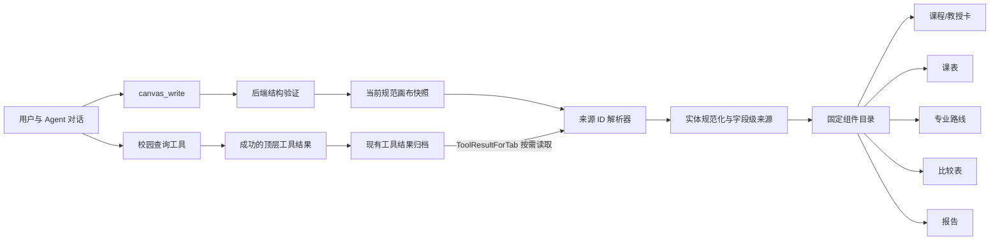

# Pathfinder 咨询画布设计规格

日期：2026-07-28

状态：用户已确认（2026-07-28）；MIT-only 选型已按完整运行时依赖树复核

适用范围：`desktop/frontend`、`internal/campus/native`，以及现有 Wails 工具结果归档接口

## 1. 背景与目标

Pathfinder 当前以聊天为主要咨询界面，已经具备校园课程、教授评分、专业信息、实时课表等工具能力，也具备 `TodoRail`、工具卡片、Markdown、Mermaid 和工具结果归档机制。问题是：重要结论仍散落在对话和工具调用中，用户需要自行把课程、教授、时间冲突、先修关系和专业路径拼接成一幅完整图景。

本设计在不替换现有聊天运行时的前提下，增加右侧“咨询画布”。聊天继续承担提问、解释和决策讨论；画布承担稳定、可扫描、可比较和可回看的结构化结果。画布中的事实必须能够追溯到真实工具结果，不允许模型为了填满卡片而猜测数据。

首期目标：

1. 在右侧提供“咨询状态”和“咨询画布”两个主视图。
2. 提供概览、课表、专业路线、比较、报告五类固定画布视图。
3. 提供固定样式的课程卡片和教授卡片。
4. 引入 `canvas_write`，让模型声明“如何展示哪些已有证据”，而不是生成任意前端代码。
5. 复用现有工具结果归档和历史恢复能力，使画布随会话持久化并可重建。
6. 复用成熟开源组件完成课表、关系图和比较表，避免重复实现底层交互。
7. 本次新增的第三方组件、插件及其传递依赖只允许 MIT 许可证。

## 2. 非目标

首期不包含：

- 不替换现有聊天、消息、Agent 或 Wails 运行时。
- 不允许模型输出任意 HTML、JavaScript、CSS、React 组件或 `className`。
- 不引入通用低代码编辑器，也不让用户自由拖拽修改所有布局。
- 不自动执行选课、退课、改专业、发邮件或其他外部写操作。
- 不根据教授姓名猜测邮箱地址。
- 不在首期引入复杂的跨会话知识库、多人协作或云同步协议。
- 不把全部现有工具输出都强制转换为可视组件；无匹配视图时继续使用现有工具卡片和 Markdown。

## 3. 设计原则

### 3.1 对话与画布分工

- 对话是讨论面：提出目标、补充约束、解释取舍、确认下一步。
- 画布是理解面：保存当前最重要的结构化结论，便于扫描、比较和回看。
- 对话中的新证据不会自动覆盖画布；只有一次成功的顶层 `canvas_write` 才会更新规范画布快照。

### 3.2 证据引用，而非事实复制

`canvas_write` 主要保存视图配置、实体选择和源工具调用 ID。课程学分、评分、难度、评论数等事实在渲染时从对应的已归档工具结果读取。这样可以避免同一事实同时存在于聊天文本、工具输出和画布 JSON 中而发生漂移。

### 3.3 固定组件目录

模型只能从受信任的视图和组件目录中选择：课程卡、教授卡、课表、路线图、比较表、报告。布局、颜色、交互和无障碍行为由前端控制。模型只决定展示对象、证据来源、有限的语义状态与报告内容。

### 3.4 渐进式信息密度

画布默认展示决策所需的核心字段；先修课详情、评论样本、来源元数据等放在展开区或证据抽屉中。用户无需先阅读长段对话，也不会被一次性展示的全部字段淹没。

## 4. 信息架构与用户体验

### 4.1 桌面布局

保留当前三栏框架。右侧区域改为两个一级标签：

1. **咨询状态**：承载现有 `Todos / Known / Unknown`，保持当前进度管理能力。
2. **咨询画布**：承载可视化结果。

咨询画布顶部包含：

- 画布标题。
- 最近更新时间。
- 来源状态，例如“6 项证据 · 1 项不可用”。
- 视图切换器：概览、课表、专业路线、比较、报告。只显示当前快照实际包含的视图。
- “定位到对话”入口，用于回到产生当前画布的 `canvas_write` 工具卡片。

画布主体不提供通用自由布局。每种视图拥有固定的响应式布局：

- 概览：卡片网格。
- 课表：周视图和紧凑日程列表。
- 专业路线：可缩放路线图和可访问的线性备用列表。
- 比较：表格；窄屏转换为逐项对比卡。
- 报告：结构化 Markdown 和来源列表。

### 4.2 窄屏与窗口压缩

当主内容空间不足时，右侧画布转换为覆盖式抽屉，而不是继续压缩聊天。抽屉应保留当前选中的视图和滚动位置。课表默认切换为日/列表视图，比较表切换为卡片堆叠，路线图同时提供线性路径列表。

### 4.3 空、加载与错误状态

- 尚无画布：显示简短说明和示例提问，例如“帮我比较 ECS 036A 和 ECS 032A”。
- 正在恢复来源：保留布局骨架并显示单项加载状态。
- 某一来源不可用：只影响依赖该来源的实体，其他卡片继续显示；字段显示“来源不可用”，不显示猜测值。
- 整个新快照无效：保留上一份有效快照，并在 `canvas_write` 工具卡片上呈现验证错误。
- 历史快照中的部分工具结果被清理：显示可恢复的标题/视图框架和明确缺失状态，不伪造旧数据。

## 5. 画布数据协议

### 5.1 `canvas_write` 工具

新增只读、计划安全的校园原生工具 `canvas_write`。它与 `todo_write` 一样用于更新界面状态，不代表外部世界中的写操作。工具只接受版本化 JSON；后端完成结构验证，前端完成引用解析和实体规范化。

建议的首期参数：

```json
{
  "version": 1,
  "title": "2026 秋季选课方案",
  "active_view_id": "overview",
  "views": [
    {
      "id": "overview",
      "kind": "overview",
      "title": "概览",
      "source_tool_call_ids": ["call_course_1", "call_rmp_1"],
      "entity_keys": ["course:ECS 036A", "professor:12345"]
    },
    {
      "id": "schedule",
      "kind": "schedule",
      "title": "课表",
      "source_tool_call_ids": ["call_live_schedule_1"]
    },
    {
      "id": "route",
      "kind": "major_route",
      "title": "专业路线",
      "source_tool_call_ids": ["call_major_1", "call_course_2"],
      "route": {
        "nodes": [
          {
            "id": "ecs36a",
            "kind": "course",
            "entity_key": "course:ECS 036A",
            "label": "ECS 036A",
            "term": "2026 Fall",
            "status": "planned",
            "source_tool_call_ids": ["call_course_2"]
          }
        ],
        "edges": []
      }
    },
    {
      "id": "comparison",
      "kind": "comparison",
      "title": "课程比较",
      "source_tool_call_ids": ["call_course_1"],
      "entity_type": "course",
      "entity_keys": ["course:ECS 036A", "course:ECS 032A"]
    },
    {
      "id": "report",
      "kind": "report",
      "title": "咨询报告",
      "source_tool_call_ids": ["call_course_1", "call_rmp_1"],
      "markdown": "## 建议\n\n优先考虑 ECS 036A，并在选课前核对先修要求。"
    }
  ]
}
```

### 5.2 结构约束

顶层约束：

- `version` 首期必须为 `1`。
- `title` 为 1–80 个 Unicode 字符。
- `views` 为 1–6 项。
- `active_view_id` 必须引用 `views` 中存在的唯一 ID。
- 视图 `id` 在快照内唯一，只允许字母、数字、下划线和短横线，长度 1–40。
- `kind` 只能是 `overview`、`schedule`、`major_route`、`comparison`、`report`。
- 每个视图最多引用 12 个工具调用；去重后按声明顺序处理。

视图约束：

- `overview.entity_keys` 最多 24 项。
- `comparison.entity_keys` 为 2–12 项，且实体类型必须一致。
- `comparison.entity_type` 只能是 `course`、`professor` 或 `major`。
- `major_route` 最多 40 个节点和 80 条边。
- 节点 `kind` 只能是 `course` 或 `milestone`。
- 节点 `status` 只能是 `planned`、`completed`、`blocked` 或 `optional`。
- 边 `relation` 只能是 `prerequisite`、`required`、`recommended` 或 `sequence`。
- 每条边的起点和终点必须存在，不允许自环；首期允许有向环但会显示数据警告，因为部分课程关系可能不是严格的 DAG。
- `report.markdown` 最多 12,000 个 Unicode 字符，并使用现有受控 Markdown 渲染路径。
- 未在协议中定义的字段一律拒绝，防止通过扩展字段注入样式或代码。

### 5.3 引用约束

- 只解析当前会话中成功完成的顶层工具调用。
- `canvas_write`、`todo_write` 以及失败、取消、嵌套工具调用不能作为事实来源。
- 来源工具应属于受支持的校园证据工具，例如课程数据库、教授评分、专业目录、转专业要求和实时课表。
- 一个实体必须能够从其声明来源中解析出来才会渲染完整卡片。
- `entity_key` 是选择器，不是事实容器。推荐格式为 `course:<规范课程代码>`、`professor:<稳定 numeric_id>`、`major:<稳定标识>`。
- 当同一实体出现在多个来源中时，按字段来源策略合并，而不是按“最后一个结果覆盖全部字段”。每个显示字段保留来源工具调用 ID。

### 5.4 快照与历史

- 当前画布由最新一次成功的顶层 `canvas_write` 完整替换，而不是增量合并。
- 最新成功快照必须保留完整参数，不能像普通工具结果一样立即丢弃。
- 更早的快照可以使用现有归档机制保存；恢复历史消息时，通过现有 `ToolResultForTab(tabId, toolId)` 按需读取。
- 切换会话时，每个标签页拥有独立画布状态。
- 如果最新快照验证失败，当前有效画布不变。
- 首期不支持多个并列命名画布；若需要不同方案，使用不同会话或由后续版本增加快照切换器。

## 6. 可信实体模型与字段来源

前端增加纯函数式规范化层，把不同工具输出转换为统一实体。规范化层同时输出字段值、来源 ID、新鲜度和缺失原因。组件不直接读取原始工具 JSON。

### 6.1 课程实体与课程卡

课程卡固定展示：

| 区域 | 字段 | 来源与缺失策略 |
| --- | --- | --- |
| 标题 | 课程代码、课程名称 | `query_course_db`；缺一时显示已有字段 |
| 核心指标 | 学分 | `units`；未知显示“学分未收录” |
| 评分 | 平均评分、评论数 | `avg_rating`、`num_reviews`；无评论时显示“暂无评分” |
| 难度 | 平均难度 | `avg_difficulty`；未知不以 0 代替 |
| 要求 | 先修课摘要 | `prerequisites`；长内容折叠 |
| 属性 | GE 标签 | `general_education`；为空则隐藏 |
| 证据 | 来源、更新时间/数据新鲜度 | 由工具元数据生成 |

固定操作：

- “加入比较”：更新前端的临时比较选择；需要持久化时由下一轮对话产生新的 `canvas_write`。
- “查看先修路线”：若当前已有路线视图则定位对应节点；否则在输入框预填询问，不自动发送。
- “继续咨询”：在输入框预填包含课程代码的问题，不自动发送。
- “查看证据”：展开来源工具与字段映射。

卡片不接受模型提供的颜色、图标或标签样式。评分颜色阈值由全局设计系统统一定义；未知值使用中性样式。

### 6.2 教授实体与教授卡

教授卡固定展示：

| 区域 | 字段 | 来源与缺失策略 |
| --- | --- | --- |
| 标题 | 教授姓名、院系/学校 | `query_rmp_professors` 或 `professors_for_course` |
| 联系 | 已验证邮箱 | 仅接受未来官方目录或其他明确可信来源；当前无来源时显示“邮箱未收录” |
| 评分 | 平均评分、评分人数 | `avg_rating`、`num_ratings` |
| 难度 | 平均难度 | `avg_difficulty` |
| 意愿 | Would take again 百分比 | `would_take_again_percent`；未知则隐藏指标 |
| 外链 | RMP 页面 | 仅使用工具返回的 `rmp_url`，不由模型拼接 URL |
| 证据 | 来源、更新时间/数据新鲜度 | 由工具元数据生成 |

固定操作：加入比较、查看教授相关课程、继续咨询、打开经验证的 RMP 链接、查看证据。

**邮箱规则：** 当前课程和 RMP 工具不提供教授邮箱，实时课表桥接层也明确过滤 `@ucdavis.edu` 邮箱。因此首期必须显示“邮箱未收录”，不得从姓名、学校域名或其他模式推断邮箱。未来只有在增加官方 UC Davis 人员目录等经过批准的数据源后，才显示“已验证邮箱”和 `mailto:` 操作。

### 6.3 字段级合并

当多个来源包含同一实体时，使用显式优先级：

1. 课程名称、学分、先修要求、GE：课程数据库。
2. 教授评分字段和 RMP URL：RMP 工具。
3. 学期、节次、地点、授课教师安排：实时课表。
4. 专业要求和里程碑：专业目录或转专业工具。

不同来源的字段可以组合到一张卡中，但来源抽屉必须按字段显示证据。冲突值不静默覆盖：显示首选来源值，并在证据抽屉标记冲突。

## 7. 五类画布视图

### 7.1 概览

概览将指定实体渲染为课程卡、教授卡和后续可扩展的专业摘要卡。桌面使用自适应两列卡片网格；较窄时单列。实体顺序遵循 `entity_keys`。无法解析的实体保留小型缺失卡，说明缺失的来源或选择器。

### 7.2 课表

课表使用实时课表工具的结构化数据，支持：

- 周视图、日视图和紧凑列表。
- 课程颜色由稳定哈希生成，不接受模型指定。
- 同时段重叠、跨校区时间风险和短换教室间隔的可视提示。
- 点击课块显示课程、section、地点、教师、时间和报名状态等来源已有字段。
- 课表为空时区分“尚未查询”“查询成功但无课程”“来源不可用”。

首期不在课表上直接拖拽改课。用户点击“讨论调整”时，只在聊天输入框中预填相关课程和冲突信息。

### 7.3 专业路线

路线图使用受控节点和边：

- 课程节点由课程实体补全标题、学分和评分摘要。
- 里程碑节点可表示“完成数学先修”“提交转专业申请”等来源支持的要求。
- 状态使用固定视觉语义：已完成、计划中、受阻、可选。
- 点击节点打开右侧详情或卡片，不在图中堆叠长文本。
- 图形视图之外必须提供按学期/顺序排列的线性列表，兼顾键盘和屏幕阅读器。

模型可以提出路线结构，但每个事实性课程节点和关系都必须带来源引用。没有证据支持的建议只能标记为 `recommended`，并在详情中明确为“咨询建议”，不能伪装为官方要求。

### 7.4 比较

比较视图按实体类型使用固定列：

- 课程：课程、学分、评分、难度、评论数、先修摘要、GE。
- 教授：教授、院系、评分、难度、再次选课比例、评分人数、邮箱状态。
- 专业：专业名称、所属学院、关键要求、申请门槛、来源状态；精确字段根据当前专业工具的稳定输出收敛。

表格默认允许排序、列显隐和行高亮，但这些是本地 UI 状态，不修改规范快照。缺失值始终与数值 0 区分。移动端按实体展示对比卡，并突出各字段差异。

### 7.5 报告

报告复用现有受控 Markdown 渲染，并增加：

- 固定的“结论 / 依据 / 风险与未知 / 下一步”视觉分区建议。
- 页面顶部显示报告依赖的来源和新鲜度。
- 报告中的普通文本不能创建自动执行操作。
- 外部链接继续经过现有安全策略；来源 URL 只从工具结果读取。
- 首期提供报告级来源列表，不承诺自动生成逐句学术引用。对关键事实，模型应在文本中使用课程代码/实体名称，让用户能够在来源抽屉核对。

## 8. 开源组件选择

所有新增第三方依赖在合入前记录精确版本、许可证并运行依赖审计。本项目此次新增依赖采用 **MIT-only** 策略：直接依赖和因这些依赖新增的传递依赖都必须为 MIT；出现 Apache-2.0、BSD、ISC、MPL、GPL、LGPL、AGPL、商业许可证、双重许可证但未明确选择 MIT，或许可证无法识别的包时，不得合入。若候选库的实际锁定版本不能通过审计，则更换 MIT-only 方案或使用项目内实现。

| 能力 | 选型 | 许可证 | 首期用途 | 选择原因 |
| --- | --- | --- | --- | --- |
| 课表 | [FullCalendar 6.1.19](https://github.com/fullcalendar/fullcalendar) 与 [React 适配器](https://github.com/fullcalendar/fullcalendar-react) | MIT | 周/日/列表式时间网格、事件交互 | 锁定的 v6 React/Core/TimeGrid/DayGrid 包均为 MIT，新增运行时依赖只有 MIT 的 Preact；v7 因 Temporal 依赖树不满足 MIT-only 而禁用 |
| 路线图 | [Cytoscape.js 3.33.1](https://github.com/cytoscape/cytoscape.js) | MIT | 课程与专业路线、缩放、适配视口、节点选择 | 包本身无运行时依赖，可直接通过 React ref 封装，避免引入非 MIT 的 D3 依赖树 |
| 比较表 | [TanStack Table](https://github.com/TanStack/table) | MIT | 排序、列显隐、表格状态 | Headless，能直接沿用 Pathfinder 现有 CSS 与设计令牌 |

计划安装的首期包以实施时的官方文档和兼容性检查为准，预期包括：

- `@fullcalendar/react@6.1.19`
- `@fullcalendar/core@6.1.19`
- `@fullcalendar/timegrid@6.1.19`
- `@fullcalendar/daygrid@6.1.19`
- `cytoscape@3.33.1`
- `@tanstack/react-table`

锁定版本的运行时许可证证据：

- FullCalendar 6.1.19：`@fullcalendar/react` 无普通依赖，peer 到 `@fullcalendar/core`；Core 的唯一普通依赖是 `preact~10.12.1`。React、Core、TimeGrid、DayGrid 和 Preact 均为 MIT。
- Cytoscape.js 3.33.1：MIT，发布包无 `dependencies` 和 `peerDependencies`。
- TanStack React Table 8.21.3：MIT，唯一普通依赖 `@tanstack/table-core@8.21.3` 也是 MIT；React/ReactDOM 为项目既有 MIT peer。
- 实施时必须使用精确版本写入 lockfile，并以实际安装后的生产依赖树再次生成许可证清单；上述研究记录不能替代合入前审计。

暂不采用的方案：

- **assistant-ui / CopilotKit OpenGenerativeUI**：适合重建或主导聊天与生成式 UI 运行时，但会与现有 Wails、消息历史和工具卡片架构大面积重叠。
- **Google A2UI / Vercel json-render**：可信组件目录和声明式 UI 思路与本设计一致，但其 Apache-2.0 许可证不符合本项目 MIT-only 约束，因此不进入实现或依赖树。
- **Schedule-X**：主包为 MIT，但当前 React 集成需要 `temporal-polyfill@0.3.0`，其依赖树无法通过 MIT-only 白名单，因此不采用。
- **React Flow / xyflow**：主包为 MIT，但运行时依赖 `@xyflow/system`，后者继续引入 ISC 许可证的 D3 包，因此不采用。
- **FullCalendar 7**：主包为 MIT，但要求的新版 Temporal 依赖树包含非 MIT 包；实现必须锁定已审计的 6.1.19，不允许自动升级到 v7。
- **shadcn/ui**：Pathfinder 当前不以 Tailwind/Radix 为基础；为两类固定卡片引入整套样式栈收益有限。首期沿用现有 CSS 变量、Lucide 图标和组件习惯。
- **LangChain Open Canvas**：面向通用文档编辑，架构和交互目标与咨询证据画布不同。
- **AG-UI**：适用于更完整的 Agent 事件协议；当前需求不需要迁移既有事件和历史协议。

上表之外的研究项目即使技术上合适，只要不是 MIT 或其锁定版本无法证明满足 MIT-only，也只能作为设计参考，不能复制代码、打包或运行时加载。许可证审计范围仅针对本功能新增的依赖增量；现有仓库既有依赖的许可证治理不在本规格范围内，但本功能不得使其许可证面进一步扩大。

## 9. 前后端数据流



推荐模块边界：

- Go：`canvas_write` 参数结构、严格校验、工具注册和系统提示说明。
- 前端状态层：从消息历史选择最新成功快照，负责标签页隔离。
- 来源加载器：批量去重工具调用 ID，通过现有桥接接口按需恢复结果并缓存。
- 规范化层：工具输出适配器、实体索引、字段来源和冲突检测。
- 组件目录：`CourseCard`、`ProfessorCard`、五类视图及其错误边界。
- 画布外壳：标签、响应式抽屉、视图选择、来源状态和对话定位。

## 10. 交互与状态更新

画布内操作分三类：

1. **纯本地浏览状态**：切换视图、排序、展开证据、缩放路线图。立即执行，不产生工具调用。
2. **对话准备状态**：继续咨询、讨论冲突、查询先修。只预填输入框并聚焦，由用户确认发送。
3. **规范画布状态**：改变持久化实体选择、增加视图或重构路线。通过用户发出的对话请求和后续 `canvas_write` 完整更新，不在前端暗中改写 Agent 快照。

外部导航仅限来源中已有且通过 URL 校验的链接。任何未来可能产生外部写入的操作都需要独立工具和明确确认，不属于 `canvas_write`。

## 11. 安全、隐私与可访问性

### 11.1 安全和可信渲染

- 严格 JSON 解码并拒绝未知字段。
- 不接受 HTML、JS、CSS、SVG 源码、事件处理器、任意组件名或远程图片。
- Markdown 使用现有安全渲染链路，不放宽原始 HTML 策略。
- 外链只接受工具返回并通过协议/域名安全检查的 URL。
- 工具调用 ID 必须属于当前标签页，防止跨会话读取。
- 所有解析器对数组长度和文本长度设上限，避免异常快照造成 UI/内存压力。
- 可视化组件位于错误边界内，单个视图失败不能使聊天界面崩溃。
- CI 对本功能新增依赖执行许可证白名单检查，白名单只包含 `MIT`；无法识别或多许可证结果默认失败并要求人工核验。

### 11.2 隐私

- 不从实时课表桥接层恢复或猜测被有意过滤的教师邮箱。
- 画布只展示当前校园工具已经允许进入对话的数据。
- 不把工具结果自动发送到新的第三方服务；选用的前端库必须能够完全本地渲染。

### 11.3 可访问性和国际化

- 所有卡片和控制项支持键盘焦点与可见焦点环。
- 评分不能只靠颜色表达，同时显示文本/数值。
- 路线图提供线性列表；课表提供列表视图；比较表使用正确的表头语义。
- 图标按钮提供可翻译的 accessible name。
- 中文为当前默认文案，组件字符串集中管理，为英文切换保留接口。
- 支持浅色/深色主题和系统“减少动态效果”偏好。

## 12. 测试与验收

### 12.1 Go 单元测试

- 合法的五类视图参数能够通过。
- 拒绝未知版本、未知字段、未知 `kind`、重复 ID 和不存在的 `active_view_id`。
- 验证所有数量、字符串长度、枚举、边引用和自环限制。
- `canvas_write` 被标记为只读和计划安全。
- 失败调用不会替换已有有效快照。

### 12.2 前端单元测试

- 从消息历史中选择最新成功的顶层 `canvas_write`，忽略嵌套、失败和取消调用。
- 最新快照保留完整参数，旧快照按需归档和恢复。
- 来源 ID 去重、标签页隔离、缓存和不可用状态正确。
- 每类工具输出正确规范化为课程、教授、专业和课表实体。
- 缺失值与 0 区分；字段级优先级和冲突标记正确。
- 教授无官方邮箱来源时必须显示“邮箱未收录”，且不存在推断逻辑。
- 未知组件类型和非法 URL 不会被渲染。

### 12.3 组件测试

- 课程卡和教授卡字段、缺失态、来源抽屉和预填操作符合固定契约。
- 课表能够处理重叠事件、空日程和窄屏列表。
- 路线图节点/边、状态、fit view 和线性备用列表可用。
- 比较表排序、列显隐、缺失值和移动端卡片一致。
- 报告 Markdown 不执行原始 HTML 或脚本。
- 单视图错误不会影响聊天和其他画布视图。

### 12.4 集成与回归

- 现有 `TodoRail` 行为保持不变，只移动到“咨询状态”标签。
- 现有工具卡片、消息虚拟化、历史恢复和标签页切换不回归。
- TypeScript 检查、前端单测、生产构建和相关 Go 测试全部通过。
- 新增直接依赖及其传递依赖通过 MIT-only 许可证审计，并将报告作为验收证据保留。
- 在 Wails 桌面壳中完成一次人工 smoke test：新会话、历史会话、多标签页、窗口压缩、深色模式。

### 12.5 用户可见验收场景

1. 用户请求比较两门课程后，右侧出现课程比较视图，课程卡可显示课程名、学分、评分和缺失字段状态。
2. 用户询问某门课的教师后，教授卡显示姓名和评分；当前没有邮箱来源时明确显示“邮箱未收录”。
3. 用户查询当前课表后，右侧显示周课表；冲突时间有明显提示。
4. 用户规划转专业路径后，路线图显示课程/里程碑及来源；咨询建议与官方要求有视觉区分。
5. 关闭并重新打开历史会话后，画布能从归档工具结果恢复；缺失来源不会导致错误事实。
6. 模型尝试传入任意 HTML、样式或未知组件时，`canvas_write` 验证失败且旧画布保持可用。

## 13. 分阶段交付

### 阶段 A：协议与画布骨架

- `canvas_write`、严格验证、系统提示和历史快照选择。
- 右侧“咨询状态 / 咨询画布”外壳、响应式抽屉、加载与错误状态。
- 来源加载器、统一实体类型和基本证据抽屉。

### 阶段 B：固定卡片与比较

- 课程、教授规范化器和固定卡片。
- TanStack Table 比较视图。
- 卡片预填咨询、加入临时比较、来源查看。

### 阶段 C：课表与路线

- FullCalendar 6.1.19 课表与冲突提示。
- Cytoscape.js 3.33.1 专业路线、固定节点、线性备用列表。

### 阶段 D：报告、打磨与验收

- 报告视图、来源摘要、全部响应式与无障碍打磨。
- 历史恢复、错误边界、性能与 Wails smoke test。

每一阶段都应保持可构建、可测试，并避免在同一提交中顺带重构无关聊天逻辑。

## 14. 后续可选方向

首期稳定后再评估：

- 官方人员目录数据源与经过验证的教授邮箱。
- 多方案快照和并排比较。
- 从画布导出 PDF/分享报告。
- 使用项目内 SVG/CSS 展示简单的学期负担、评分分布或完成进度；若未来引入图表库，必须先通过 MIT-only 全依赖树审计。
- 视图目录显著扩张后，只评估许可证为 MIT 且传递依赖通过 MIT-only 审计的通用声明式协议。
- 在明确确认和独立安全工具支持下，增加实际选课或日历写入流程。

## 15. 设计决策摘要

本方案选择“证据引用型咨询画布”，而不是让模型自由生成界面。它最大限度复用 Pathfinder 已有的聊天、校园工具和归档机制，同时只选用 MIT 许可证并通过新增传递依赖审计的组件：FullCalendar 6.1.19 负责课表，Cytoscape.js 3.33.1 负责路线，TanStack Table 负责比较。课程与教授信息由固定组件展示，字段来源清晰，缺失就明确缺失；尤其教授邮箱在当前无可信来源时绝不推断。该边界既能显著增强用户理解能力，也能控制生成式 UI 常见的事实漂移、样式失控、许可证扩散和安全风险。
